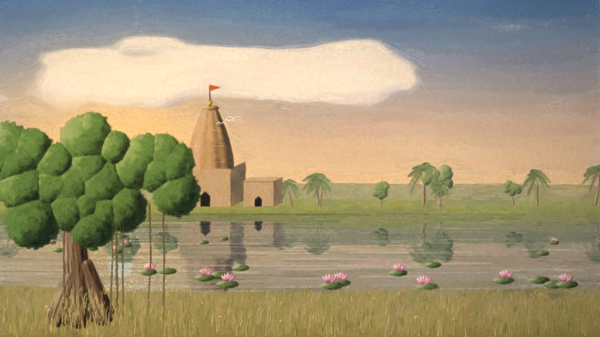

# Dry-Media Painter

Type a sentence, get a painting. **No AI, no internet, no image models.** Plain TypeScript reads your words,
composes a scene out of procedural shapes, and paints it stroke by stroke with simulated pastel, charcoal or
gouache on cold-pressed cotton paper. It also repaints photos.

```
"an ancient temple beside a lotus pond at sunset with egrets and a huge banyan tree on the left"
```



## Run it

**No install:** open `docs/index.html` in any browser (double-click it). It works offline.

**Command line** (Node 18+):

```bash
npm install
npm run paint -- --text "two fishing boats on a misty lake at dawn, mountains behind" out.png
npm run paint -- scenes/temple-pond.ts out.png --medium charcoal     # a hand-written scene file
npm run photo -- photo.jpg out.png --preset pastel                   # repaint a photo
npm run photo -- photo.jpg out.png --preset faithful                 # close copy: fine strokes, true colours
npm run photo -- photo.jpg out.png --preset exact [--target 0.995]   # reproduce the photo; prints how closely it matched
npm run build                                                         # rebuild docs/index.html
```

Every render also writes `out.under.png` (the code-drawn scene before the brushes) and, for text, `out.scene.json`.

## How it works

```
words ──► parser ──► scene (JSON) ──► shapes in code ──► underpainting ──► brush engine ──► painting
          src/scene/parse.ts   src/scene/elements.ts         src/paint.ts + src/core/*
```

1. **Words → scene** (`src/scene/parse.ts`). A ~300-word vocabulary maps words to ideas: time of day, weather,
   places, buildings, trees, animals, people, boats, counts ("three boats"), colours ("red boat"), sizes
   ("huge banyan"), positions ("on the left", "under a tree") and medium ("charcoal"). Composition rules set the
   horizon, layer things back to front, keep the subject on a third, push trees to the edges, and tint every
   colour to the light (golden hour, dusk, night, rain…). Unknown words are listed as skipped.
2. **Scene → underpainting** (`src/scene/elements.ts`). Each element draws itself with lighting: solids are
   unions of capsules and ellipses shaded from a fake 3D normal; terrain uses noise heightfields; water mirrors
   what's above it; mist and haze fade distance. Every element also says which way brush strokes should run
   (water across, grass up, leaves around each clump) and can hand fine linework (grass, birds, fronds, roots)
   straight to the brushes.
3. **Underpainting → painting** (`src/paint.ts`). A toned wash, then brushes from big to small. Each pass only
   places strokes where the canvas still differs from the target, and each stroke grows along the flow field
   until its colour stops matching. The brush lays pigment on the paper's raised tooth first and leaves bristle
   streaks. Then linework, charcoal contours on real edges, optional hatching, and a light-and-colour grade.

## Scene files

A scene is plain data, so you can write one by hand (`scenes/temple-pond.ts`) or edit the `.scene.json` the
parser saved. Positions: `x` is a fraction of width, `y` of height; sizes are fractions of height; `depth`
0 = near, 1 = far. Elements: `sky`, `clouds`, `terrain` (mountain, hill, dune, ground), `water`, `mist`, `tree`
(broadleaf, banyan, pine, cypress, palm, bare), `forest`, `grass`, `building` (flat, gable, dome, shikhara),
`figure`, `animal` (elephant, cow, deer, horse, dog, goat), `boat`, `birds`, `lotus`, `lamps`, `rain`,
`snowfall`, `glow`, `polygon`, `blob` (sculpt anything from capsules and ellipses), `library` (any object from the library, below),
`studio` (photo backdrop and glossy floor), `road`, `reflect` (mirrors one element in the floor or water) and `custom` (your own code).

## Media

`pastel` (default), `charcoal`, `gouache`, `impressionist`, and `faithful` (a close copy of a reference photo: small brushes
everywhere, no colour drift, no tint or vignette; roughly 3.5x lower pixel error than `pastel` on the same image), and `exact`: every paper and brush effect that would move a
pixel off the photo is switched off, brushes go down to 1 px, and the painter measures itself against the reference
(`src/metrics.ts`: pixel error, PSNR, SSIM) and repaints until the match reaches the target (default 99%, defined as the
lower of 1 - error/255 and SSIM). If strokes stall below the target, a last pass of single-pixel dabs finishes the job,
so on very busy images (text, fine patterns) the result is a pixel-accurate copy built from strokes and dabs, not a loose painting. Each is a set of numbers in `src/presets.ts`:
brush sizes per pass, how faithful each pass is, grain, streaks, taper, wobble, contours, hatching, grade.

## The object library

Anything with real structure is a *library entry* in `src/library/`: its trigger words, how to read options from your
sentence, where it likes to stand, and the code that draws it. Right now: **supercar** (side-view wedge profile with
wheel arches cut from the body, gloss paint bands, glass, side intake, spoked wheels over ventilated discs and calipers,
no badges), **lighthouse** (banded tower, gallery, glowing lantern at night, keeper's cottage, reflected in the water),
and **windmill** (tower, cap, lattice sails).

```bash
npm run paint -- --text "a red supercar with yellow brake calipers in a studio" car.png
npm run paint -- --text "a yellow sports car on a mountain road at sunset" road.png
npm run paint -- --text-file notes/ferrari-spec.txt ferrari.png        # a whole paragraph of description
npm run paint -- scenes/supercar-studio.ts car.png                       # a hand-written scene using the library
```

Colour words attach to the thing they describe: in "bright yellow brake calipers" the yellow goes to the calipers and
the paint colour is whatever the rest of the text votes for. Words that only name a part of an object ("prancing horse"
badge, "bumper", "tyre") are absorbed by it instead of turning into a horse.

## Teach it new things

1. **A new object:** copy `src/library/windmill.ts`, change the drawing, and add it to `ENTRIES` in `src/library/index.ts`.
   The parser, scene files and the web app pick up its words automatically. The engine never changes.
2. **A new word** for something that already exists: add it to `VOCAB` in `src/scene/parse.ts`.
3. **A new kind of scenery** (not an object): add an element in `src/scene/elements.ts`.

## Credits

Inspired by [Jatayu-Javascript](https://github.com/ytsav/Jatayu-Javascript), a single hand-coded dry-media
artwork. This project contains no code from it. Stroke placement follows Aaron Hertzmann, *Painterly Rendering
with Curved Brush Strokes of Multiple Sizes* (SIGGRAPH 1998).
